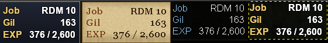

# playerstats

An [Ashita v4](https://www.ashitaxi.com/) addon for Final Fantasy XI that keeps your job, level, gil and experience on screen in a small, movable box.

```
Job   RDM 10
Gil      163
EXP  376 / 2,600
```

- **Job** shows your main job and level, plus your support job and level when one is set (`WAR 37 / NIN 18`).
- **Gil** is your current gil, with thousands separators.
- **EXP** is your current experience and the amount needed for the next level.

The box can be dragged anywhere with the mouse, hides itself while you zone, and comes with four themes that you can customize with chat commands.

## Installation

1. Copy the `playerstats` folder into `Ashita/addons/`, so the main file ends up at `Ashita/addons/playerstats/playerstats.lua`.
2. In game, type `/addon load playerstats`.

To load it automatically, add `/addon load playerstats` to your Ashita startup script (for example `Ashita/scripts/default.txt`).

## Moving the box

Click and drag the box to move it. The new position is saved as soon as you let go.

- A small click without moving doesn't nudge the box; it has to move a few pixels before it counts as a drag.
- Clicks on the box don't pass through to the game, so you won't accidentally target something behind it.
- If the box ends up somewhere you can't reach, `/playerstats reset` puts it back at 100, 100. `/playerstats pos <x> <y>` places it exactly.

## Zoning

The box hides while you zone and stays hidden for a few seconds after you arrive. It does this because the game's memory can hold stale or zeroed values while zoning. The default wait is 3 seconds; change it with `/playerstats delay <seconds>` (`0` turns the extra wait off).

The box is also hidden at the character select screen.

## Themes



*From left to right: dark, parchment, glass, plain.*

| Theme | Look |
|---|---|
| `dark` (default) | Dark blue gradient texture, thin gold border, gold labels, white outlined numbers, bold Arial |
| `parchment` | Tan paper texture, brown border, rust labels, dark brown numbers, bold Georgia, no outline |
| `glass` | See-through black box, no border, light blue labels, white outlined numbers, regular Arial |
| `plain` | No box at all, just gold labels and white outlined numbers |

Switch with `/playerstats theme <name>`, for example `/playerstats theme parchment`.

## Customizing

Every customizing command starts from your current look and changes one thing. Once you change anything, your style is saved as a custom style; choosing a theme again replaces it.

### Colors

```
/playerstats color <part> <color>
```

| Part | What it colors |
|---|---|
| `label` | The "Job", "Gil" and "EXP" labels |
| `value` | The numbers and job text |
| `border` | The thin line around the box |
| `bg` | The box background. With a texture, this tints the texture: white (`FFFFFFFF`) leaves it as-is |

Colors are hex, either `RRGGBB` or `AARRGGBB` where `AA` is the opacity (`FF` solid, `00` invisible). A leading `#` or `0x` is fine.

```
/playerstats color label FFD700        gold labels
/playerstats color value #E0E0E0       light grey numbers
/playerstats color bg 80000000         half-transparent black background
```

### Background texture

```
/playerstats texture <file.png>
/playerstats texture off
```

The file must be in `playerstats/assets/`. The addon ships with `dark.png` and `parchment.png`, and you can add your own. The texture is stretched to fit the box, so images without a built-in border look best; use `/playerstats border` for a crisp outline instead. With the texture off, the background is a flat color set by `color bg`.

### Text

| Command | Effect |
|---|---|
| `/playerstats font <name>` | Font family, for example `/playerstats font Verdana`. Names with spaces work: `/playerstats font Times New Roman` |
| `/playerstats size <n>` | Font size (default 12) |
| `/playerstats bold` | Turns bold on or off |
| `/playerstats outline` | Turns the dark text outline on or off. Outlines help light text stay readable over busy scenery |
| `/playerstats border` | Turns the box border on or off |

If a font isn't installed, the game falls back to a default font. On Linux under Proton or Wine, only the fonts in your Wine prefix are available.

## All commands

`/pstats` works as a short form of `/playerstats` for every command. Typing `/playerstats` by itself prints the list in game.

| Command | Description |
|---|---|
| `/playerstats theme <dark\|parchment\|glass\|plain>` | Switch to a built-in theme |
| `/playerstats color <label\|value\|border\|bg> <color>` | Change one color |
| `/playerstats texture <file.png\|off>` | Set or remove the background texture |
| `/playerstats font <name>` | Change the font |
| `/playerstats size <n>` | Change the font size |
| `/playerstats bold` | Toggle bold text |
| `/playerstats outline` | Toggle the text outline |
| `/playerstats border` | Toggle the box border |
| `/playerstats pos <x> <y>` | Move the box to an exact position |
| `/playerstats reset` | Move the box back to 100, 100 |
| `/playerstats delay <seconds>` | How long to stay hidden after zoning in |

## Settings

Settings are saved per character by Ashita, under `Ashita/config/addons/playerstats/`. That includes the position, theme, colors, font and zone delay. Deleting the folder resets everything to defaults the next time the addon loads.

### Upgrading from gilexp

playerstats was previously called gilexp. To switch:

1. `/addon unload gilexp`
2. Delete `Ashita/addons/gilexp` and install `playerstats` as above.
3. `/addon load playerstats`

Settings are stored by addon name, so the old ones aren't picked up automatically. To keep your position, copy `Ashita/config/addons/gilexp` to `Ashita/config/addons/playerstats` before loading. Custom colors from gilexp 1.1 or earlier aren't carried over in any case, because styles are stored differently since 1.2.

## Credits

Vibe Coded by Semil with Claude. Built and tested on HorizonXI's Ashita v4 client.

## License

MIT. See [LICENSE](LICENSE).
